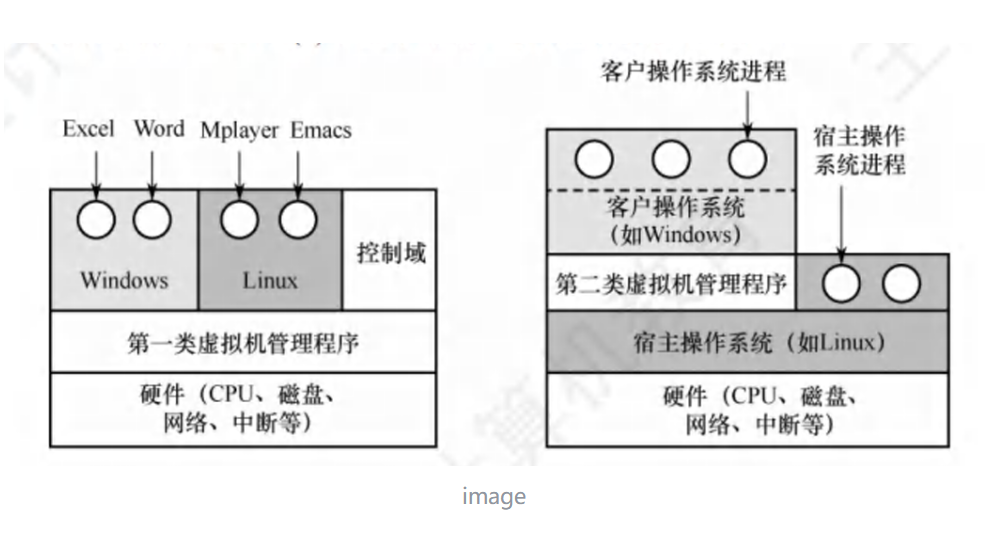

# KVM
这里面的KVM指的不是BMC操作界面的KVM，而是最基础的虚拟化技术，全称是 Kernel-based Virtual Machine; 并且该技术是开源的，它是 Linux 内核的一个模块，可以让Linux系统变成一个虚拟机控制器(Hypervisor).

KVM属于Type-1类型的虚拟化技术，可直接运行在硬件上，虚拟机的性能接近物理机。相比之下，VMware workstation 这些Type-2的虚拟化 需要先在宿主机的操作系统商运行

## Type-1 和 Type-2的区别
虚拟机的基本组件包括: 
    - 虚拟化层: 提供抽象硬件功能的接口
    - 虚拟硬件: 包括虚拟化 CPU、内存、存储和网络
    - 客户操作系统： 运行在虚拟硬件上的操作系统

最简单的理解就是，虚拟机是直接运行在硬件上的，还是再隔了一层用户态的程序。前者是 Type-1, 后者是 Type-2.


## KVM, QEMU, libvirt的关系

1) Qemu: 作为模拟器，向虚拟出来的OS提供CPU和其他硬件，Guest OS认为自己和硬件直接打交道，其实是同Qemu模拟出来的硬件打交道，Qemu将这些指令转译给真正的硬件。

2) KVM： KVM需要CPU的支持，采用硬件辅助虚拟化技术 Intel-VT, AMD-V等技术(这些东西是啥，我并不清楚，但是在Bios里面都可以开关)， 使用KVM后，Guest OS的CPU指令就可以不经过 Qemu 转译，直接运行, 从而提升速度。 KVM 通过 /dev/kvm 暴露接口，用户态程序可以通过ioctl函数来直接访问这个接口。

3) Libvirt: 目前使用最广泛的对KVM虚拟机进行管理的工具和API，Libvirt是一个 daemon进程，可以被本地 virsh调用，用来在宿主机上，使用virsh命令来管理下辖的虚拟机。

## 使用virsh
① 查看所有虚拟机及其运行状态
virsh list --all

② 查看虚拟机的详细配置（CPU、内存、磁盘、网卡等）
virsh dominfo <虚拟机名称>

③ 获取虚拟机的 IP 地址
virsh domifaddr <虚拟机名称>

④ 查看虚拟机的磁盘文件位置
virsh domblklist <虚拟机名称>

① 检查生命周期与开机状态
virsh start <虚拟机名称>

① 从宿主机进入虚拟机
virsh console <虚拟机名称>

① 硬重启虚拟机
virsh reset <虚拟机名称>

## 虚拟化中的CPU

可以通过 lscpu 这条命令的完整查看来确认一些信息
```
Architecture:                x86_64                 # 架构
  CPU op-mode(s):            32-bit, 64-bit         # CPU的运行模式，同时支持32位和64位
  Address sizes:             46 bits physical, 48 bits virtual
  Byte Order:                Little Endian          # 字节序
CPU(s):                      104                    # 共有104个逻辑CPU
  On-line CPU(s) list:       0-103                  # 实际在线CPU数
Vendor ID:                   GenuineIntel           # 厂商与型号具体信息
  Model name:                Intel(R) Xeon(R) Platinum 8167M CPU @ 2.00GHz      # CPU具体型号
    CPU family:              6
    Model:                   85
    Thread(s) per core:      2                      # 每个核心可以开2个超线程
    Core(s) per socket:      26                     # 每个CPU有26个物理核心
    Socket(s):               2                      # 2个物理CPU插槽(双路CPU)
    Stepping:                4
    CPU(s) scaling MHz:      100%
    CPU max MHz:             2400.0000
    CPU min MHz:             1000.0000
    BogoMIPS:                4000.00
    Flags:                   fpu vme de pse tsc msr pae mce cx8 apic sep mtrr pge mca cmov pat pse36 clflush dts acpi mmx fxsr sse
                              sse2 ss ht tm pbe syscall nx pdpe1gb rdtscp lm constant_tsc art arch_perfmon pebs bts rep_good nopl
                             xtopology nonstop_tsc cpuid aperfmperf pni pclmulqdq dtes64 ds_cpl vmx smx est tm2 ssse3 sdbg fma cx1
                             6 xtpr pdcm pcid dca sse4_1 sse4_2 x2apic movbe popcnt tsc_deadline_timer aes xsave avx f16c rdrand l
                             ahf_lm abm 3dnowprefetch cpuid_fault epb cat_l3 cdp_l3 pti intel_ppin ssbd mba ibrs ibpb stibp tpr_sh
                             adow flexpriority ept vpid ept_ad fsgsbase tsc_adjust bmi1 hle avx2 smep bmi2 erms invpcid rtm cqm mp
                             x rdt_a avx512f avx512dq rdseed adx smap clflushopt clwb intel_pt avx512cd avx512bw avx512vl xsaveopt
                              xsavec xgetbv1 xsaves cqm_llc cqm_occup_llc cqm_mbm_total cqm_mbm_local dtherm ida arat pln pts hwp
                             hwp_act_window hwp_epp hwp_pkg_req vnmi pku ospke md_clear flush_l1d arch_capabilities
Virtualization features:                    
  Virtualization:            VT-x                       # 虚拟化支持，支持 Intel VT-x 硬件虚拟化
Caches (sum of all):                                    
  L1d:                       1.6 MiB (52 instances)     
  L1i:                       1.6 MiB (52 instances)     # 数据/指令一级缓存，每个物理核各一份 
  L2:                        52 MiB (52 instances)      # 二级缓存
  L3:                        71.5 MiB (2 instances)     # 三级缓存
NUMA:                                           
  NUMA node(s):              2                          # 每一个物理CPU就是一个NUMA节点
  NUMA node0 CPU(s):         0-25,52-77                 # CPU0的物理核是 0-25, 对应超线程是 52-77
  NUMA node1 CPU(s):         26-51,78-103               # CPU1的物理核是 26-51, 对应超线程是 78-103
Vulnerabilities:                                        
  Gather data sampling:      Mitigation; Microcode      # 现代内核针对CPU硬件漏洞的缓解状态报告
  Indirect target selection: Not affected
  Itlb multihit:             KVM: Mitigation: Split huge pages
  L1tf:                      Mitigation; PTE Inversion; VMX conditional cache flushes, SMT vulnerable
  Mds:                       Mitigation; Clear CPU buffers; SMT vulnerable
  Meltdown:                  Mitigation; PTI
  Mmio stale data:           Mitigation; Clear CPU buffers; SMT vulnerable
  Reg file data sampling:    Not affected
  Retbleed:                  Mitigation; IBRS
  Spec rstack overflow:      Not affected
  Spec store bypass:         Mitigation; Speculative Store Bypass disabled via prctl
  Spectre v1:                Mitigation; usercopy/swapgs barriers and __user pointer sanitization
  Spectre v2:                Mitigation; IBRS; IBPB conditional; STIBP conditional; RSB filling; PBRSB-eIBRS Not affected; BHI Not
                              affected
  Srbds:                     Not affected
  Tsa:                       Not affected
  Tsx async abort:           Mitigation; Clear CPU buffers; SMT vulnerable
  Vmscape:                   Mitigation; IBPB before exit to userspace

```
## 虚拟化中的网卡

常见的三种虚拟化技术中，网卡的分配

| 类型 | 本质是什么 | 性能 | 灵活性（热迁移、共享等） | 典型场景 |
| --- | --- | --- | --- | --- |
| **普通虚拟网卡 (virtio / e1000)** | 软件模拟出来的网卡，流量走宿主机的虚拟交换机/bridge | 中等 | 最高（支持热迁移、随时增删） | 绝大多数普通业务虚拟机 |
| **SR-IOV** | 把一张物理网卡切成多个“小网卡”（VF），每个 VF 直接给虚拟机 | 很高 | 中等（一般不支持热迁移） | 多台虚拟机共享一张高性能网卡 |
| **PCI 直通 (Passthrough)** | 把整块物理网卡的 PCI 设备直接交给虚拟机独占 | 最高 | 最低（虚拟机独占，热迁移困难） | 极致性能、RDMA、DPDK、低延迟场景 |

其中重点说明SR-IOV（Single Root I/O Virtualization）技术，因为目前我最常接触的就是这些内容, 特点有:

* 物理网卡硬件本身要支持可"切分"
* 一个物理网卡可被切分为:
    - 1个PF(Physical Function,宿主机自己用)
    - 多个VF(Virtual Function,分配给虚拟机)
每个VF都像是独立的网卡，可直接映射给虚拟机,数据路径不用经过宿主机内核，速度更快,多台虚拟机可以共享同一张物理网卡
对于已经开了VF的机器，可以使用下列命令查看对应的信息。

```
ip link show [网卡名称]
2: ens35f0np0: <BROADCAST,MULTICAST,UP,LOWER_UP> mtu 1500 xdp qdisc mq state UP mode DEFAULT group default qlen 10000
    link/ether b8:59:9f:2b:b6:72 brd ff:ff:ff:ff:ff:ff
    prog/xdp id 41 name ebpf_tracer_sta tag bbf56f5e66a411ee jited
    vf 0     link/ether 00:00:00:00:00:00 brd ff:ff:ff:ff:ff:ff, spoof checking off, link-state auto, trust off, query_rss off
    vf 1     link/ether 00:00:00:00:00:00 brd ff:ff:ff:ff:ff:ff, spoof checking off, link-state auto, trust off, query_rss off
    altname enp59s0f0np0
    altname enxb8599f2bb672

```
